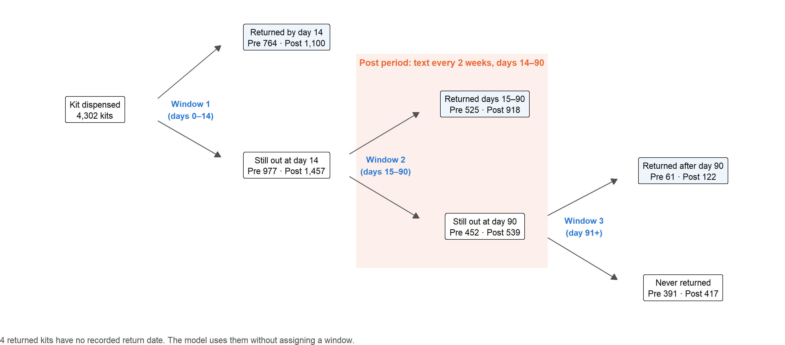
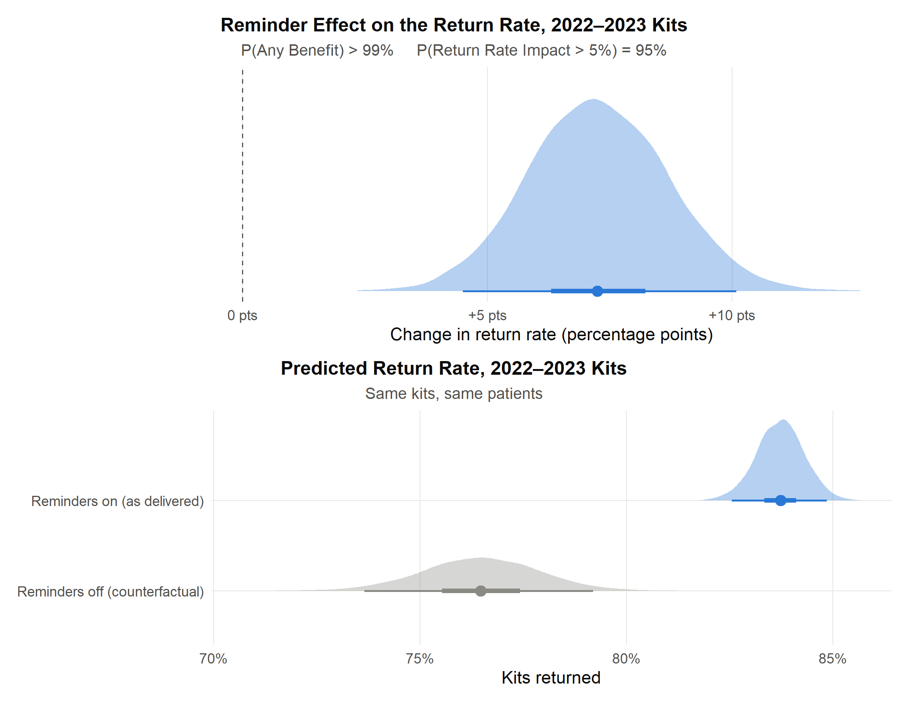
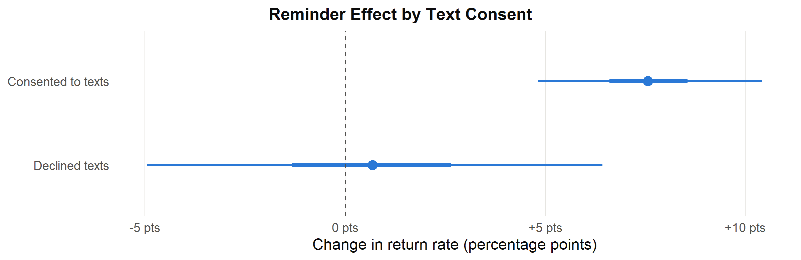
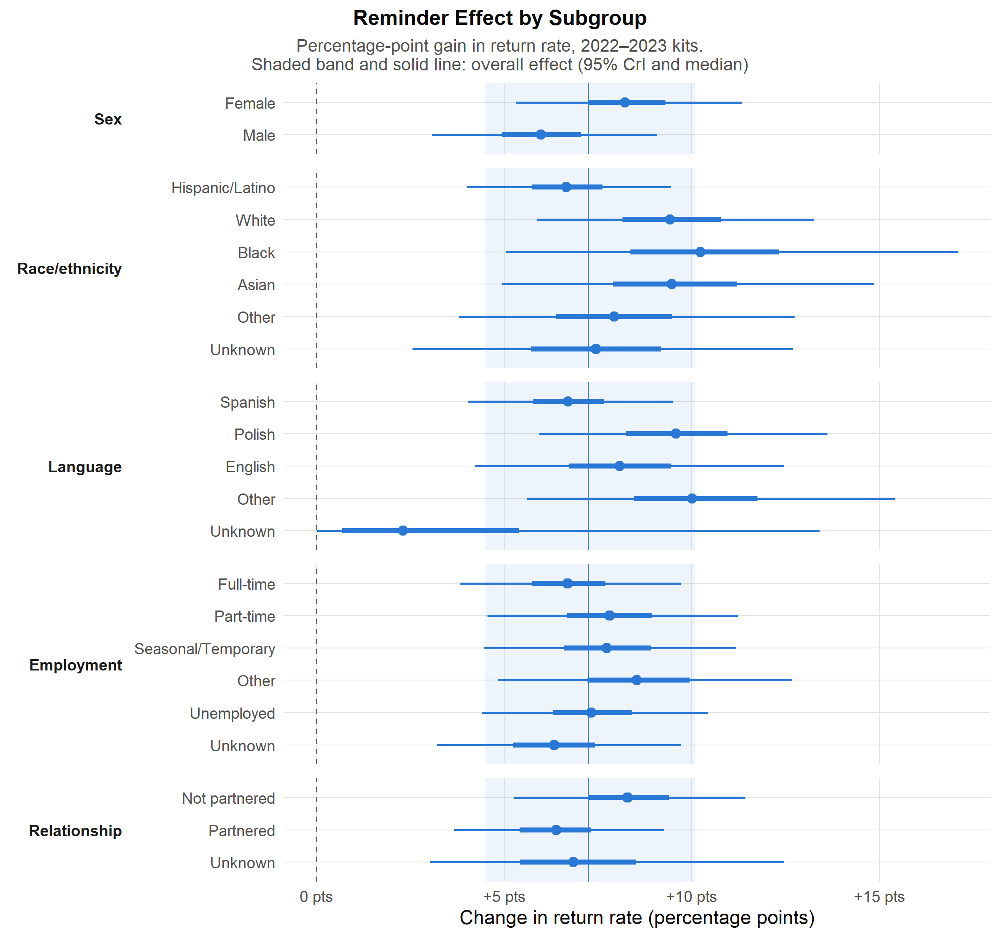

# Text Reminders and FIT Kit Returns

In January 2022, the clinic started texting patients whose FIT kits were still out 14 days after dispense, with a text every 2 weeks until the kit came back or day 90. Over the same stretch, the share of kits returned rose from 77.6% (2019–2021) to 83.7% (2022–2023). Some of that rise would likely have happened anyway, from COVID recovery, staffing changes, or a different mix of patients.

This project answers 3 questions:

> 1. How much of the rise in returns came from the text reminders?
> 2. Did patients who declined texts improve too?
> 3. Did reminders work better for some patients than others?

The full write-up, with every figure and diagnostic, is in [`03_output/04_model_report_v2.html`](03_output/04_model_report_v2.html).

## Key Findings

- **Reminders raised the return rate by about 7 percentage points.** With reminders, an estimated 83.7% of 2022–2023 kits were returned. With the program switched off for the same kits and patients, the model estimates 76.5%. Return Rate Impact = 7.2 points, 95% CrI [4.5, 10.1], with P(Any Benefit) > 99% and P(Return Rate Impact > 5%) = 95%.
- **In clinic terms, that is about 93 more completed screening tests a year**, 95% CrI [58, 129], at the 2022–2023 volume of about 1,280 kits a year.
- **The gain only shows up once the texts start.** The share of kits returned by day 14, before any text goes out, barely moved (43.9% → 43.0%). The share of still-out kits returned in days 15–90 rose from 53.7% to 63.0%.
- **Patients who declined texts saw almost no gain**: 0.7 points, 95% CrI [−5.0, 6.4], against 7.6 points, 95% CrI [4.8, 10.4], for patients who consented.
- **Women and older patients responded a little more.** Other subgroup differences were small and uncertain.

## Data

The analysis uses **4,302 FIT kits** dispensed to **2,092 patients** between January 2019 and December 2023: 1,742 kits before reminders began and 2,560 after. A kit counts as returned if it came back at any point before the data were pulled. The latest return in the file is June 5, 2024, so every kit had at least 5 months to come back.

The raw extract has one row per patient, with kits spread across wide columns. My first step was an audit ([`01_audit_clean.R`](02_scripts/01_audit_clean.R)) that reshapes it to one row per kit, corrects date typos, removes same-day duplicate kits, and re-derives race/ethnicity from the source columns. Every check and correction is logged in [`03_output/audit/`](03_output/audit/), and the variables are described in [`data_dictionary.csv`](01_data/clean/data_dictionary.csv).

Repeated kits are common. 55% of patients received more than 1 kit, and 78% of kits come from these patients. Most of them return all of their kits or none, so treating each kit as independent would overstate how much the data can tell us.

## The Model

How can the reminder effect be separated from everything else that changed in 2022?

The model is a Bayesian hierarchical logistic model written in Stan ([`kit_returns_stage.stan`](02_scripts/stan/kit_returns_stage.stan)). I describe it below in the order it was built.

### Three Windows per Kit

A reminder could only influence a kit still out at day 14, and mainly during days 15–90, since texts stopped as soon as the kit came back and stopped for good at day 90. As such, I follow each kit through 3 windows:

- **Window 1 (days 0–14):** was the kit returned by day 14? No kit had received a text yet, before or after 2022.
- **Window 2 (days 15–90):** for kits still out at day 14, was the kit returned by day 90? This is where the texts were sent.
- **Window 3 (day 91+):** for kits still out at day 90, was the kit ever returned? Texts had stopped by then.



*Each kit passes through up to 3 windows. Texts only went out during window 2 of 2022–2023 kits.*

**Why the windows help.** Reminders could only act in window 2, while most other changes (staffing, kit type, patient mix) would affect every window. Comparing the post-2022 change in window 2 with the change in window 1 separates the reminder effect from everything else. The first 14 days work like a control group built into the timeline.

**Key assumption.** Without reminders, the post-2022 changes would have shifted returns in each window by the same amount on the log-odds scale.

Window 3 gets its own post-2022 term (the "carry-over"), which captures late responses to the final texts without counting them as active reminder time. The 4 returned kits with no recorded return date stay in the model, which averages over the 3 windows for them.

### Time and Patient Adjustment

**Time.** A post-2022 indicator, a linear calendar trend, a COVID period (March 2020–June 2021), and an Oct–Dec dispense indicator keep secular trends, COVID recovery and seasonality from being credited to the reminders. The post-2022 indicator applies to all 3 windows, and window 1 pins it down.

**Patient characteristics.** Age at each kit's dispense date, sex, household size, relationship status, employment, race/ethnicity, preferred language, text consent, and first vs. repeat kit. These adjust for differences between the 2019–2021 and 2022–2023 cohorts.

### Patient Random Effects

Each patient gets 2 random effects: a tendency to return kits promptly (window 1) and a tendency to return them later (windows 2–3). The two are allowed to correlate. This is what lets the model handle patients who return every kit or none.

### Subgroup Reminder Effects

The reminder effect can differ by sex, race/ethnicity, language, employment and relationship status, and can change linearly with age and household size. The subgroup deviations within each factor sum to 0, so the main reminder term is the average effect across groups and each deviation is a group's difference from that average.

**Partial pooling.** All subgroup deviations share one spread parameter, τ, learned from the data. Small groups are pulled toward the overall effect unless their data show a clear difference, which matters here because several race/ethnicity and language groups have fewer than 50 patients.

### Text-Consent Placebo Check

Patients who declined texts should show no reminder effect. They get their own unpooled terms in both window 2 and window 3, so the data can show a gap between decliners and consenters if one exists. Without the window 3 term, decliners inherit the consenters' carry-over and appear to gain about 3 points from texts they never received.

### Effects in Percentage Points

The reminder term lives on the log-odds scale, which is hard to read in a clinic. To put the result in percentage points, I predict each 2022–2023 kit's return probability twice, once as delivered and once with the reminder and carry-over terms switched off, then average the difference across kits. Subgroup effects average the same difference over each subgroup's kits.

### Mathematical Specification

For kit $i$ from patient $j$, let $p_{1i}$, $p_{2i}$ and $p_{3i}$ be the probabilities of return in windows 1, 2 and 3, each given the kit was still out when the window began:

$$P(\text{Returned}_i) = p_{1i} + (1 - p_{1i})\,p_{2i} + (1 - p_{1i})(1 - p_{2i})\,p_{3i}$$

$$
\begin{aligned}
\text{logit}(p_{1i}) &= \alpha_1 + \mathbf{x}_i^\top\boldsymbol\beta + \beta_{\text{post}}\,\text{post}_i + u_{j1}\\
\text{logit}(p_{2i}) &= \alpha_2 + \mathbf{x}_i^\top\boldsymbol\beta + \beta_{\text{post}}\,\text{post}_i + \beta_{\text{covid,late}}\,\text{covid}_i + \text{post}_i \cdot R_i + u_{j2}\\
\text{logit}(p_{3i}) &= \alpha_3 + \mathbf{x}_i^\top\boldsymbol\beta + \beta_{\text{post}}\,\text{post}_i + \beta_{\text{covid,late}}\,\text{covid}_i + \text{post}_i \cdot C_i + u_{j2}\\
R_i &= \beta_{\text{remind}} + \delta^{\text{sex}}_{s[i]} + \delta^{\text{race}}_{r[i]} + \delta^{\text{lang}}_{l[i]} + \delta^{\text{emp}}_{e[i]} + \delta^{\text{rel}}_{m[i]} + \gamma_{\text{age}}\,\text{age}_i + \gamma_{\text{fam}}\,\text{fam}_i + \boldsymbol\gamma_{\text{con}}^\top \mathbf{c}_i\\
C_i &= \beta_{\text{carry}} + \boldsymbol\gamma_{\text{carry,con}}^\top \mathbf{c}_i\\
\delta^{(f)} &\sim \text{Normal}(0, \tau), \quad \textstyle\sum_k \delta^{(f)}_k = 0\\
(u_{j1}, u_{j2}) &\sim \text{MVNormal}\big(\mathbf{0},\ \text{diag}(\boldsymbol\sigma_u)\,\boldsymbol\Omega\,\text{diag}(\boldsymbol\sigma_u)\big)
\end{aligned}
$$

$R_i$ is the reminder effect for kit $i$, $C_i$ is its carry-over after day 90, and $\mathbf{c}_i$ holds the "declined texts" and "consent unknown" indicators. $\beta_{\text{remind}}$ is the average reminder effect for patients who consented to texts.

### Priors

The priors are weakly informative on the log-odds scale. They rule out implausible values, such as one covariate multiplying the odds of return by 1,000, and leave everything else to the data.

| Parameter | Prior | Meaning |
|---|---|---|
| Window baselines $\alpha$ | Normal(0, 1.5) | Baseline return probabilities anywhere from about 5% to 95% |
| Covariate, period, reminder and consent effects | Normal(0, 1) | Odds ratios mostly between 0.14 and 7 |
| Age and household-size moderation $\gamma$ | Normal(0, 0.5) | Modest changes in the reminder effect per unit |
| Subgroup spread $\tau$ | Half-Normal(0, 0.5) | Subgroup differences expected to be small unless the data show otherwise |
| Patient spread $\sigma_u$ | Half-Normal(0, 2) | Allows large differences between patients |
| Patient correlation $\Omega$ | LKJ(2) | Mildly favors moderate correlations |

I fit the model with CmdStan: 4 chains, 1,000 warmup and 1,500 sampling iterations each, for 6,000 posterior draws.

## Results

### Reminder Effect

How much did the reminders raise the return rate?



*The reminder program raised the 2022–2023 return rate by about 7 points, and almost all of the posterior sits above 0.*

Among 2022–2023 kits, the reminder program raised the return rate from an estimated 76.5% to 83.7%. Return Rate Impact = 7.2 points, 95% CrI [4.5, 10.1]. At the clinic's volume, that works out to about 93 more completed screening tests each year, 95% CrI [58, 129].

On the odds scale, reminders roughly doubled the odds of a return during days 15–90: OR = 2.12, 95% CrI [1.46, 3.21]. Other changes after 2022 had no clear effect, with OR = 1.01, 95% CrI [0.76, 1.34]. Once time trends, COVID and season are in the model, the rise in returns is credited to the reminders.

Returns after day 90, once texts had stopped, also rose: carry-over OR = 2.93, 95% CrI [1.89, 4.60]. I count this as part of the reminder effect. Only 991 of 4,302 kits were still out at day 90, but this term may still account for a meaningful share of the 7-point gain.

### Text-Consent Placebo Check

Did patients who never received texts improve too?



*Patients who declined texts gained almost nothing, which is what the reminders predict.*

| Group | Return Rate Impact (points) | 95% CrI |
|---|---|---|
| Consented to texts | 7.6 | [4.8, 10.4] |
| Declined texts | 0.7 | [−5.0, 6.4] |

P(Consenter Gain > Decliner Gain) = 99%. The decliner group is small (117 kits in 2022–2023), so its interval is wide. Still, the gap points the way the reminders predict, which is a good sign.

### Reminder Effects by Subgroup

Did reminders work better for some patients than others?



*Every subgroup gained, and every interval overlaps the overall effect (shaded band).*

- **Sex.** Women gained 8.2 points, 95% CrI [5.3, 11.3], and men gained 6.0 points, 95% CrI [3.1, 9.1]. The gap is Women − Men = 2.3 points, 95% CrI [0.1, 4.5], with P(Women Gain > Men Gain) = 98%.
- **Age.** On the log-odds scale, the reminder effect grows per decade of age by γ_age = 0.20, 95% CrI [−0.01, 0.43], with P(γ_age > 0) = 97%.
- **Race/ethnicity, language, employment and relationship.** The differences are small, and the shared spread is small too (τ = 0.13, 95% CrI [0.02, 0.30]), so these groups stay close to the overall estimate.
- **Language.** Polish-speaking patients gained 9.6 points and Spanish-speaking patients 6.7. Most of that gap comes from the Polish group's lower baseline return rate, since the same odds ratio produces a bigger percentage-point gain from a lower starting point. Patients whose language had no matching text version gained 10.0 points, so the data do not show that language-matched messages drove the effect.

### Other Predictors of Return

Which patients return kits, regardless of reminders? These odds ratios are adjusted for every other factor and for each patient's own tendency to return.

| Predictor | OR | 95% CrI |
|---|---|---|
| Age (per 10 years) | 1.27 | [1.13, 1.43] |
| Partnered (vs. not partnered) | 1.24 | [1.03, 1.51] |
| First kit (vs. repeat kit) | 1.21 | [1.05, 1.39] |
| COVID period | 0.77 | [0.61, 0.99] |
| Dispensed Oct–Dec | 0.72 | [0.61, 0.83] |

Older and partnered patients were more likely to return kits. Kits dispensed in October–December were less likely to come back, which may reflect holidays and travel, winter mail delays, or year-end outreach pushes that reach less-engaged patients. Race/ethnicity and language groups have wide intervals, because most are small, and none is clearly different from the reference group.

### Differences Between Patients

How much do patients differ beyond their recorded characteristics? A lot. The median odds ratio compares 2 randomly chosen patients with identical characteristics. For returns after day 14, MOR = 5.1, 95% CrI [4.0, 6.7], so a typical pair of otherwise identical patients differs about 5-fold in their odds of returning a kit. That is larger than any covariate effect in the table above.

A patient's prompt and later tendencies are positively correlated, ρ = 0.61, 95% CrI [0.46, 0.75]. Prompt returners also tend to be eventual returners, though the two tendencies are distinct. Patients with only 1 or 2 kits are pulled toward the average, and the model only moves a patient far from 0 when they have a consistent record across several kits.

## Model Checking

**Convergence.** 0 divergent transitions, a maximum R-hat of 1.005, and a minimum bulk effective sample size of 556 (for ρ). All 4 chains ran in parallel in about 7 minutes.

**Posterior predictive check.** I simulated new datasets from the fitted model and compared them with the observed data. Every observed statistic falls inside the predicted range, including the share of multi-kit patients who returned every kit (64.8% observed vs. 62.5%–67.7% predicted) and the share who returned none (5.9% vs. 4.5%–7.2%). That all-or-none pattern is the hardest one to reproduce without patient effects, so I treat it as the most important row.

**Prior predictive check.** I ran the same model with the likelihood switched off. Before seeing data, the reminder effect is centered on 0, with a 95% range of −10 to +16 points, so the prior allows reminders to help, harm or do nothing. After fitting, the posterior is far narrower, and the conclusion comes from the data.

**Seasonal term.** I added the Oct–Dec term after the EDA showed a sharp drop in returns for kits dispensed in late 2023. Because I chose it after seeing the outcome, I refit the model without it ([`05_compare_no_q4.R`](02_scripts/05_compare_no_q4.R)). The reminder effect barely moves (7.25 points with the term, 7.37 without). The time terms do shift: without the Oct–Dec term, the calendar trend turns more negative and the non-reminder post-2022 change rises to OR = 1.21, 95% CrI [0.92, 1.56]. As such, I kept the term.

## What to Keep in Mind

The rise in returns after day 90 could be patients acting on the final texts a few days late, or some other post-2022 change that only touched very late returns, and these data cannot tell the two apart. Since the carry-over is counted in the 7-point gain, the effect of the texts themselves during days 15–90 may be somewhat smaller.

Text delivery was not recorded for individual patients. I assumed that every consenting patient with a kit still out at day 14 received a text every 2 weeks until they returned it or reached day 90. Also, patients were identified through FIT orders between November 2021 and November 2023, so 2019–2021 kits only come from patients who were still with the clinic once reminders began.

Finally, there is no randomized control group. The window comparison and the consent placebo both support a causal reading, but both rest on the key assumption that other post-2022 changes would have shifted every window equally.

## Conclusion and Next Steps

Overall, I am satisfied with this model. It follows the actual reminder schedule, handles repeated kits from the same patient, passes its diagnostics and predictive checks, and the placebo check points the right way. If given more time, I would first run a pre-period placebo test with a fake reminder start in 2021, since the main estimate leans on the equal-shift assumption. Next, I would split the reminder effect into its days 15–90 and after-day-90 parts to see how much of the gain comes after the texts stop.

Other analyses on my list:

- Refit with wider and narrower priors
- A frequentist cross-check (a generalized linear mixed model with the same structure)
- Restrict to guideline-eligible ages (50–75 before May 2021, 45–75 after)
- Restrict to patients with kits in both periods
- Let the reminder effect differ between 2022 and 2023, and between first and repeat kits

## Repository

```
01_data/
  raw/crc_raw.xlsx              raw extract, one row per patient
  clean/                        kits, patients, patient_period tables and data dictionary
02_scripts/
  01_audit_clean.R              audit and reshape to one row per kit
  02_eda.Rmd                    exploratory analysis
  03_fit_stage_model.R          fit the model (main, or the "no_q4" sensitivity)
  04_model_report_v2.Rmd        full model report
  05_compare_no_q4.R            compare the main fit with the no-Oct–Dec refit
  stan/kit_returns_stage.stan   Stan model
03_output/
  audit/                        audit log and corrections
  figures/                      report figures
  models/                       CmdStan draws and summary tables
  02_eda.html, 04_model_report_v2.html
```

### Reproducing the Results

The scripts use R 4.4 with [cmdstanr](https://mc-stan.org/cmdstanr/) and an installed CmdStan, plus the tidyverse, posterior, ggdist, patchwork and bayesplot packages. Run everything from the project root (the folder with the `.Rproj` file):

```
Rscript 02_scripts/01_audit_clean.R
Rscript 02_scripts/03_fit_stage_model.R
Rscript 02_scripts/03_fit_stage_model.R no_q4
Rscript 02_scripts/05_compare_no_q4.R
Rscript -e "rmarkdown::render('02_scripts/04_model_report_v2.Rmd', output_dir = '03_output')"
```

The main fit writes its draws and summaries to `03_output/models/stage_model/`, and the prior-only run to `03_output/models/stage_model_prior/`.
